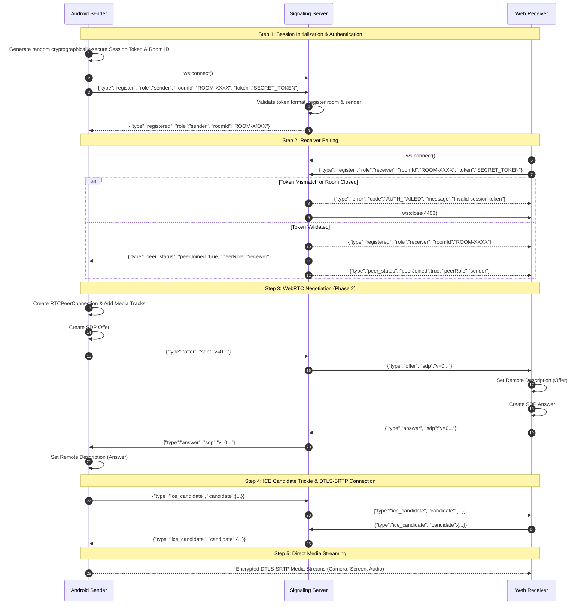

# Live Device Stream — Architecture Specification

## 1. System Overview

**Live Device Stream** is an authenticated, real-time streaming system designed to stream video (camera), audio (microphone), and screen capture from a personal Android 12 device to a web browser receiver on a computer.

The architecture strictly adheres to Android privacy guidelines, explicit user consent, encrypted transport, and zero unauthenticated telemetry or cloud dependencies.

```mermaid
flowchart LR
    subgraph Android["Android 12 Device"]
        UI["MainActivity (UI & Consent)"]
        FGS["StreamForegroundService (Persistent Notification)"]
        CAP["Capture Engines\n(CameraX / AudioRecord / MediaProjection)\n[Phase 2]"]
        RTC_S["WebRTC PeerConnection (Sender)"]
        SIG_A["SignalingClient (WebSocket)"]

        UI -->|User Action & Consent| FGS
        FGS --> CAP
        CAP --> RTC_S
        SIG_A <-->|Auth & SDP/ICE Handshake| RTC_S
    end

    subgraph Signaling["Signaling Server (Node.js)"]
        WSS["WebSocket Server (WSS/HTTPS)"]
        AUTH["Auth Verifier (Token / Room)"]
        ROOM["Room Manager (Peer Routing)"]

        WSS --- AUTH
        AUTH --- ROOM
    end

    subgraph Web["Web Receiver (Browser)"]
        SIG_W["SignalingClient (WebSocket)"]
        RTC_R["WebRTC PeerConnection (Receiver)"]
        DASH["Responsive Dashboard (HTML5 / CSS / JS)"]
        VID["Video Elements & Audio Context"]

        SIG_W <-->|Auth & SDP/ICE Handshake| RTC_R
        RTC_R -->|Decrypted Media Tracks| VID
        DASH --> SIG_W
    end

    SIG_A <===>|WSS (Token Auth + JSON-RPC)| WSS
    WSS <===>|WSS (Token Auth + JSON-RPC)| SIG_W
    RTC_S <===>|DTLS-SRTP Media & DataChannel (Direct P2P / TURN)| RTC_R
```

---

## 2. Signaling and WebRTC Handshake Flow

The signaling server mediates room establishment and cryptographic credential exchange. Once signaling succeeds, media flows directly peer-to-peer via DTLS-SRTP (or relayed via authenticated TURN if direct traversal fails).



---

## 3. Security and Authentication Model

1. **Authentication Token Lifecycle**:
   - The Android sender generates a high-entropy session token (cryptographically secure random 128-bit hex string or 8-digit alphanumeric pairing code) upon session creation.
   - The token is never shared publicly, persisted in unencrypted storage, or sent over unencrypted connections.
   - The Web receiver must supply the exact matching token upon connection.
   - Authentication failures result in immediate socket termination with WebSocket close code `4403` (Forbidden).

2. **Transport Security**:
   - **Local Network**: During development/testing, HTTPS/WSS can use self-signed certificates or localhost port forwarding (`adb reverse tcp:8443 tcp:8443`). Browsers enforce secure context (`https://` or `http://localhost`) for WebRTC APIs.
   - **Remote Access**: WSS with TLS 1.3 certificates (e.g., Let's Encrypt), HTTPS web hosting, and DTLS 1.2+ for WebRTC peer connection.
   - **DTLS-SRTP**: All media and data channel streams are end-to-end encrypted with DTLS-SRTP using ephemeral certificates negotiated between sender and receiver.

---

## 4. Android 12 Constraints & Privacy Architecture

### 4.1 Target & Compatibility
- **Device OS**: Android 12 (API level 31, `S`).
- **Target SDK**: 34 (Android 14) with backward compatibility to API 26+.
- **Compile SDK**: 34.

### 4.2 Foreground Service & Type Declarations
Android 10 introduced `foregroundServiceType`, and Android 14 made specific types mandatory for foreground capture. In the manifest and runtime:
```xml
<service
    android:name=".service.StreamForegroundService"
    android:foregroundServiceType="mediaProjection|camera|microphone"
    android:exported="false" />
```
Runtime start must pass the combined bitmask:
```kotlin
ServiceInfo.FOREGROUND_SERVICE_TYPE_MEDIA_PROJECTION or
ServiceInfo.FOREGROUND_SERVICE_TYPE_CAMERA or
ServiceInfo.FOREGROUND_SERVICE_TYPE_MICROPHONE
```

### 4.3 MediaProjection Lifecycle Constraints
- **Consent Flow**: Must be triggered via `MediaProjectionManager.createScreenCaptureIntent()` and handled via `ActivityResultContracts.StartActivityForResult()`.
- **Foreground Service Order**: On API 29+, the foreground service **must be running** before or when calling `MediaProjectionManager.getMediaProjection(resultCode, data)`.
- **Single-Use Token**: Android 14+ restricts `MediaProjection` instances to a single `VirtualDisplay`. When restarted, fresh consent must be requested.
- **`onStop()` Handling**: Must register `MediaProjection.Callback` to handle user revocation via system notification or screen recorder dialog.
- **Screen Usability**: While screen sharing is active, the user can freely switch to other apps, multitask, and return to the home screen. A persistent notification remains visible with a "Stop Stream" action button.

### 4.4 Camera & Microphone Background Restrictions
- **While-In-Use Rule**: Under Android 11/12+, camera and microphone can only be accessed while the app is in the foreground, or through an active foreground service initiated when the activity was visible.
- **OS Enforcement**: If the app loses visibility, certain OEMs and stock Android 12 may pause video frame production or mute microphone audio to protect user privacy. We explicitly communicate this limitation in the UI rather than attempting forbidden bypasses.
- **Privacy Indicators**: Android 12 displays a persistent green indicator in the status bar whenever camera or mic is streaming. This cannot and must not be hidden.

---

## 5. Directory Structure

```
live-device-stream/
├── README.md                           # Quickstart and usage manual
├── ARCHITECTURE.md                     # System architecture & technical specs
├── signaling-server/                   # Authenticated WebSocket signaling
│   ├── package.json                    # Server dependencies & scripts
│   ├── certs/                          # Dev TLS certificates
│   │   └── generate-dev-certs.sh       # Certificate generation script
│   ├── src/
│   │   ├── server.js                   # WebSocket & HTTP/HTTPS server
│   │   ├── auth.js                     # Token validation & authentication logic
│   │   └── room.js                     # Room lifecycle & peer routing
│   └── test/
│       └── signaling.test.js           # Automated signaling & auth tests
├── web-receiver/                       # Responsive Web Receiver Dashboard
│   ├── index.html                      # Semantic dashboard UI
│   ├── css/
│   │   └── style.css                   # Responsive layout & theme
│   ├── js/
│   │   ├── app.js                      # Application coordinator & state
│   │   ├── signaling-client.js         # Browser WebSocket signaling client
│   │   └── webrtc-receiver.js          # WebRTC peer connection manager (Phase 1 foundation)
│   └── test/
│       └── web-client.test.js          # Automated browser client logic tests
└── android-app/                        # Native Android Application (Kotlin)
    ├── build.gradle.kts                # Root Gradle configuration
    ├── settings.gradle.kts             # Subproject settings
    ├── gradle.properties               # JVM & AndroidX settings
    ├── gradlew                         # Gradle wrapper launcher
    ├── gradlew.bat                     # Windows Gradle wrapper launcher
    ├── gradle/wrapper/                 # Gradle 8.9 wrapper binaries
    └── app/
        ├── build.gradle.kts            # App module dependencies (WebRTC, OkHttp, Coroutines)
        ├── src/
        │   ├── main/
        │   │   ├── AndroidManifest.xml # Permissions & foreground service types
        │   │   ├── java/com/livedevicestream/
        │   │   │   ├── LiveStreamApp.kt # Notification channels & init
        │   │   │   ├── MainActivity.kt  # Interactive UI & session controls
        │   │   │   ├── service/
        │   │   │   │   └── StreamForegroundService.kt # Foreground service
        │   │   │   ├── signaling/
        │   │   │   │   ├── SignalingClient.kt       # OkHttp WebSocket client
        │   │   │   │   ├── SignalingMessage.kt      # Typed JSON protocol models
        │   │   │   │   └── SignalingListener.kt     # Event listener interface
        │   │   │   ├── webrtc/
        │   │   │   │   └── WebRtcClient.kt          # WebRTC abstraction foundation
        │   │   │   └── util/
        │   │   │       ├── SessionManager.kt        # Secure token & room generator
        │   │   │       └── PermissionHelper.kt      # Android 12 permission checks
        │   │   └── res/
        │   │       ├── layout/activity_main.xml     # Clean modern UI layout
        │   │       ├── values/strings.xml
        │   │       ├── values/colors.xml
        │   │       └── values/themes.xml
        │   └── test/
        │       └── java/com/livedevicestream/
        │           └── SignalingMessageTest.kt      # JUnit tests for signaling serialization
```

---

## 6. Phase 1 vs Phase 2 Scope Separation

| Feature | Phase 1 (Foundation) | Phase 2 (Live Media Streaming) |
|---|---|---|
| **Signaling Server** | ✅ Implemented (WSS/WS, token auth, room routing, ping/pong) | ✅ Enhanced with stream_info routing |
| **Web Receiver UI** | ✅ Implemented (Connection badge, token entry, log panel, responsive layout) | ✅ Live multi-track rendering (Screen, Camera, Audio VU meter) |
| **WebRTC Scaffolding** | ✅ Configuration & state machine foundation | ✅ Full SDP offer/answer exchange, ICE trickling, multi-transceiver |
| **Android UI & Config** | ✅ Room ID generation, token display, server URL input, connection status | ✅ Stream toggles (Camera, Mic, Screen) and Camera Flip |
| **Foreground Service** | ✅ Service with notification, stop action, and proper `foregroundServiceType` | ✅ Active during capture; handles MediaProjection and background states |
| **Camera & Mic Capture** | ⏸️ Deferred | ✅ `Camera2Capturer` + WebRTC `AudioRecord` with AEC/NS |
| **Screen Capture** | ⏸️ Deferred | ✅ `MediaProjection` consent flow + `ScreenCapturerAndroid` |
